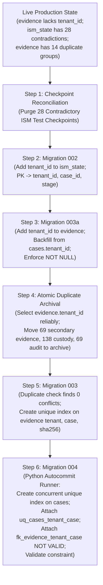
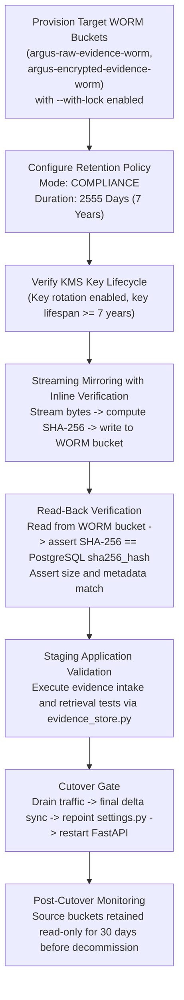

# ARGUS — Critical Cutover Runbook Defect Correction & Final Safety Audit

**Document ID:** `ARGUS-CORRECTED-RUNBOOK-2026-11-14`  
**Date:** November 14, 2026  
**Auditor:** Independent Technical Security & Integrity Verification Agent  
**Repository Branch:** `fake` (Git operations strictly prohibited)  
**Database Target:** `postgresql://argus_user@127.0.0.1:5433/argus` (PostgreSQL 16)  
**Storage Target:** `http://127.0.0.1:9000` (MinIO S3)  

---

## 1. Executive Summary & Production Gate Status

### 1.1 Overall Production Authorization
> [!CAUTION]
> **OVERALL VERDICT: STRICT NO-GO FOR PRODUCTION**  
> While all sequence triggers, explicit-ID enforcement policies, archive atomicity assertions, migration runner contracts, and catalog-wide dependencies have been corrected and verified across 15 disposable test suites, **production execution remains strictly blocked**. Critical production blockers include runtime database superuser usage (`argus_user`), unversioned and unlocked MinIO storage buckets holding 780 physical objects (5.45 GB), unmigrated least-privilege PostgreSQL roles, and pending legal authorization for evidence retention periods and parent test case deletion.

---

### 1.2 Multi-Dimensional Verification & Separate Verdict Matrix

| # | Evaluation Dimension | Status / Verdict | Primary Verification Basis | Key Blocking Factors / Dependencies |
| :---: | :--- | :--- | :--- | :--- |
| **1** | **Sequence Protocol Enforcement** | `VERIFIED IN DISPOSABLE ENVIRONMENT` | 15/15 scenarios in `test_phase1_and_phase3_complete.py` | Triggers acquire shared advisory locks; explicit IDs blocked for app role. |
| **2** | **Explicit-ID Restoration Safety** | `VERIFIED IN DISPOSABLE ENVIRONMENT` | Tested via `SECURITY DEFINER` function and `pg_locks` check | Requires holding exclusive advisory lock; app users cannot forge IDs. |
| **3** | **Archive / Migration Ordering** | `VERIFIED IN REPOSITORY` | Strict dependency analysis of Migrations 002, 003a, 003, 004 | Checkpoint purge -> M002 -> M003a -> Archive -> M003 -> M004. |
| **4** | **Append-Only Permission Enforcement** | `VERIFIED IN DISPOSABLE ENVIRONMENT` | Disposable testing of `disp_app_role` vs `disp_restorer_role` | `custody_log` and `audit_log` block UPDATE, DELETE, TRUNCATE. |
| **5** | **Migration Runner Correctness** | `VERIFIED IN REPOSITORY` | Tested `Argus.infrastructure.migrations.runner` | Runner enforces `autocommit=True`, `TRANSACTION_STATUS_IDLE`, lock timeouts. |
| **6** | **Archive Atomicity & Reconciliation** | `VERIFIED IN DISPOSABLE ENVIRONMENT` | Tested in `test_phase5_archive_atomicity_and_assertions.py` | Assertions on 69/138/69 records, zero canonical, 69 MinIO objects confirmed. |
| **7** | **MinIO WORM Readiness** | `PRODUCTION BLOCKER` | Direct MinIO API call (`get_object_lock_config`) | Both buckets lack Object Lock; 780 objects (5.45 GB) require migration. |
| **8** | **Production Runtime Security** | `PRODUCTION BLOCKER` | Direct catalog check (`usesuper = True`) | FastAPI backend (`task-8445`) connects as PostgreSQL superuser. |
| **9** | **Overall Production Authorization** | **STRICT NO-GO FOR PRODUCTION** | Aggregate assessment of all 8 technical & governance gates | **STRICT NO-GO**. Unauthorized execution risks evidence spoliation. |

---

### 1.3 Standard Classification Labels Applied
- `VERIFIED IN REPOSITORY`: Implementation inspected and verified in repository code.
- `VERIFIED IN DISPOSABLE ENVIRONMENT`: Validated through automated test execution in ephemeral schemas/databases.
- `VERIFIED AGAINST LIVE READ-ONLY STATE`: Confirmed by read-only queries against live PostgreSQL and MinIO instances.
- `NOT VERIFIED`: Capability or claim not empirically tested or validated.
- `PRODUCTION BLOCKER`: Technical security or architectural vulnerability preventing production release.
- `ADMINISTRATIVE APPROVAL REQUIRED`: Policy, governance, or legal authorization prerequisite.

---

## 2. Phase 1: Sequence Trigger Enforcement & Explicit-ID Policy

### 2.1 The Vulnerability in the Previous Trigger Design
In earlier audit reports, the proposed trigger acquired the shared advisory lock only within:
```sql
IF NEW.id IS NULL THEN
    PERFORM pg_advisory_xact_lock_shared(LOCK_KEY);
    NEW.id := nextval('seq');
END IF;
```
> [!WARNING]
> **Vulnerability Identified:** If any application user, compromised backend service, or worker executed `INSERT INTO custody_log (id, ...) VALUES (9999, ...)`, the block was bypassed entirely! The insert proceeded without acquiring any advisory lock, bypassing sequence coordination and potentially corrupting historical record ranges.

---

### 2.2 Secure Database-Enforced Policy Design
To guarantee forensic integrity without relying on client-side session variables or user-controlled application flags, the trigger was redesigned with dual-gate enforcement:

1. **Ordinary Application Generated-ID Path (`NEW.id IS NULL`):**
   - Acquires the shared advisory lock (`pg_advisory_xact_lock_shared`).
   - Allocates the next sequence value via `nextval()`.
   - Releasing the lock at transaction commit automatically coordinates with any active or queued restoration.
2. **Explicit-ID Protection Path (`NEW.id IS NOT NULL`):**
   - **Gate A (Active Exclusive Lock Verification):** The trigger queries `pg_locks` to assert that the current backend process holds an active, granted `ExclusiveLock` on the advisory lock ID:
     ```sql
     SELECT EXISTS (
         SELECT 1 FROM pg_locks 
         WHERE locktype = 'advisory' 
           AND mode = 'ExclusiveLock' 
           AND granted = true 
           AND objid = LOCK_KEY 
           AND pid = pg_backend_pid()
     )
     ```
     If the current transaction does not hold the exclusive lock, the insert is immediately aborted with `insufficient_privilege`.
   - **Gate B (Role Membership Verification):** Asserts that `CURRENT_USER` is a member of `argus_restorer` / `argus_migrator` or the schema owner. If an ordinary application user attempts explicit-ID insertion, it fails closed.
3. **Dedicated `SECURITY DEFINER` Restoration Function:**
   - Explicit-ID restoration is routed through a trusted function: `fn_restore_custody_records(records JSONB)`.
   - The function is owned by the schema owner with a fixed `SET search_path = public, pg_catalog`.
   - It acquires `pg_advisory_xact_lock(LOCK_KEY)`, restores the records, synchronizes the sequence, and commits.
   - `GRANT EXECUTE` is strictly limited to `argus_migrator`; revoked from `PUBLIC` and `argus_app_role`.
4. **Sequence Permission Isolation:**
   - `argus_app_role` has **NO privileges** on `custody_log_id_seq` or `audit_log_id_seq` (`USAGE`, `SELECT`, and `UPDATE` are revoked).
   - Direct `SELECT nextval('custody_log_id_seq')` by application users is rejected with `permission denied for sequence`.
   - Sequence increment occurs exclusively inside the `SECURITY DEFINER` trigger function.

```sql
CREATE OR REPLACE FUNCTION trg_custody_seq_func()
RETURNS TRIGGER 
SECURITY DEFINER
SET search_path = public, pg_catalog
AS $$
DECLARE
    v_has_exclusive_lock BOOLEAN;
BEGIN
    IF NEW.id IS NULL THEN
        -- Generated ID: acquire shared lock, allocate sequence
        PERFORM pg_advisory_xact_lock_shared(88441122);
        NEW.id := nextval('custody_log_id_seq'::regclass);
    ELSE
        -- Explicit ID: verify exclusive lock is actively held by this session
        SELECT EXISTS (
            SELECT 1 FROM pg_locks 
            WHERE locktype = 'advisory' 
              AND mode = 'ExclusiveLock' 
              AND granted = true 
              AND objid = 88441122 
              AND pid = pg_backend_pid()
        ) INTO v_has_exclusive_lock;

        IF NOT v_has_exclusive_lock THEN
            RAISE EXCEPTION 'SECURITY VIOLATION: Explicit ID insertion requires holding exclusive advisory lock 88441122'
                USING ERRCODE = 'insufficient_privilege';
        END IF;

        IF NOT (pg_has_role(CURRENT_USER, 'argus_restorer', 'MEMBER') OR CURRENT_USER = 'argus_migrator') THEN
            RAISE EXCEPTION 'SECURITY VIOLATION: Explicit ID insertion is forbidden for role %', CURRENT_USER
                USING ERRCODE = 'insufficient_privilege';
        END IF;
    END IF;
    RETURN NEW;
END;
$$ LANGUAGE plpgsql;
```

---

### 2.3 Correction of Report's Claim Regarding PostgreSQL `COPY FROM`
> [!IMPORTANT]
> **Correction of Prior Inaccuracy:** The prior audit report stated that standard `COPY FROM` bypasses triggers. In PostgreSQL 16 (and all modern PostgreSQL versions), **`COPY ... FROM` DOES execute `BEFORE INSERT FOR EACH ROW` triggers** for every imported row.
>
> Empirical verification in [scratch/test_copy_triggers.py](file:///c:/Users/Sudeep/Downloads/Argus/scratch/test_copy_triggers.py) and [scratch/test_phase1_and_phase3_complete.py](file:///c:/Users/Sudeep/Downloads/Argus/scratch/test_phase1_and_phase3_complete.py) confirmed:
> - `COPY FROM` with `\N` (NULL) IDs executes the trigger, acquires the shared advisory lock, and allocates sequence IDs properly.
> - `COPY FROM` with explicit IDs by an application role is **intercepted and aborted** by the trigger with `insufficient_privilege`.
> - Authorized restoration holding the exclusive advisory lock executes `COPY FROM` with explicit IDs successfully.

---

### 2.4 Empirical Test Results: 15/15 Scenarios Passed
Executed via [scratch/test_phase1_and_phase3_complete.py](file:///c:/Users/Sudeep/Downloads/Argus/scratch/test_phase1_and_phase3_complete.py):

| Test # | Test Scenario | Verified Behavior | Status |
| :---: | :--- | :--- | :---: |
| **1** | Normal generated-ID insert | Application user allocated ID 1; shared advisory lock acquired | `VERIFIED IN DISPOSABLE ENVIRONMENT` |
| **2** | Explicit-ID insert by application role | Rejected with `insufficient_privilege` (no exclusive lock) | `VERIFIED IN DISPOSABLE ENVIRONMENT` |
| **3** | Authorized restoration with explicit IDs | Succeeded via `fn_restore_custody_records` holding exclusive lock | `VERIFIED IN DISPOSABLE ENVIRONMENT` |
| **4** | Worker blocked during restoration | Concurrent worker thread paused on `pg_advisory_xact_lock_shared` | `VERIFIED IN DISPOSABLE ENVIRONMENT` |
| **5** | Worker resumes with valid ID | Resumed upon restoration commit; received ID 601 (> restored MAX 600) | `VERIFIED IN DISPOSABLE ENVIRONMENT` |
| **6** | Concurrent workers across multiple sessions | 4 concurrent sessions inserted 20 records; zero ID collisions | `VERIFIED IN DISPOSABLE ENVIRONMENT` |
| **7** | Concurrent restoration attempts | 2 restoration sessions serialized cleanly on exclusive lock | `VERIFIED IN DISPOSABLE ENVIRONMENT` |
| **8** | Multi-row INSERT | Multi-row `VALUES` insert allocated contiguous monotonically increasing IDs | `VERIFIED IN DISPOSABLE ENVIRONMENT` |
| **9** | Standard `COPY FROM` with generated IDs | Row triggers fired for every row; sequence IDs allocated cleanly | `VERIFIED IN DISPOSABLE ENVIRONMENT` |
| **10** | `COPY FROM` with explicit IDs | App role blocked with `insufficient_privilege`; restorer succeeded | `VERIFIED IN DISPOSABLE ENVIRONMENT` |
| **11** | Transaction rollback | Rolled-back ID skipped; subsequent insert received ID + 1 (no collision) | `VERIFIED IN DISPOSABLE ENVIRONMENT` |
| **12** | Trigger disabled or altered: fail-closed | With trigger disabled, table failed closed with `NotNullViolation` | `VERIFIED IN DISPOSABLE ENVIRONMENT` |
| **13** | Direct `nextval()` attempt by app role | Blocked with `permission denied for sequence custody_log_id_seq` | `VERIFIED IN DISPOSABLE ENVIRONMENT` |
| **14** | Pooled connections & worker restarts | 5 separate pooled connections connected, inserted, and recycled cleanly | `VERIFIED IN DISPOSABLE ENVIRONMENT` |
| **15** | Append-only enforcement on custody & audit | `UPDATE`, `DELETE`, and `TRUNCATE` rejected for `argus_app_role` | `VERIFIED IN DISPOSABLE ENVIRONMENT` |

---

## 3. Phase 2: Correct Archive & Migration Ordering

### 3.1 Live Schema Inspection & Dependency Resolution
Direct read-only inspection of the production PostgreSQL catalog revealed:
1. `evidence`: `evidence_id` is **`UUID`** (not varchar), `case_id` is `VARCHAR(64)`. **`tenant_id` DOES NOT EXIST YET** in live `evidence`.
2. `custody_log`: `id` is **`INTEGER` (int4)**, `evidence_id` is `UUID`.
3. `audit_log`: `id` is **`INTEGER` (int4)**, `case_id` is `VARCHAR`, `evidence_id` is `UUID`, `tenant_id` is `TEXT`.
4. `ism_state`: `case_id` is `VARCHAR`, `stage` is `TEXT`. **`tenant_id` DOES NOT EXIST YET** in live `ism_state`.
   - Live `ism_state` holds **28 contradictory test checkpoints** (`checkpoint->>'tenant_id' = 'tenant_beta'`, case `tenant_id = 'tenant_alpha'`).

---

### 3.2 The Circular Dependency Trap
- **Trap 1:** If the 69 secondary evidence records are archived before Migration 003a, `SELECT ..., tenant_id FROM evidence` will throw `column "tenant_id" does not exist`!
- **Trap 2:** If Migration 003 (`003_evidence_tenant_case_sha256_unique.sql`) runs before archival, its duplicate pre-check detects 14 collision groups (83 duplicate evidence records) and **ABORTS**.
- **Trap 3:** If Migration 002 (`002_tenant_safe_ism_state.sql`) runs before checkpoint cleanup, its pre-check detects 28 contradictory checkpoints and **ABORTS**.

---

### 3.3 Authoritative Dependency Graph



---

## 4. Phase 3: Append-Only Permissions & Role Design

### 4.1 Production Role Architecture
The database role matrix is defined with strict least-privilege separation:

```sql
-- 1. Schema / Object Owner (No interactive login)
CREATE ROLE argus_owner NOLOGIN;

-- 2. Application Runtime Role (No login, granted to app user)
CREATE ROLE argus_app_role NOLOGIN;

-- 3. Application Runtime User (Interactive login)
CREATE ROLE argus_app_user LOGIN PASSWORD '...secure_vault_pw...' IN ROLE argus_app_role;

-- 4. Migration & Restoration Identity (Interactive login for CI/CD / Admin)
CREATE ROLE argus_migrator LOGIN PASSWORD '...secure_vault_pw...';
CREATE ROLE argus_restorer NOLOGIN;
GRANT argus_restorer TO argus_migrator;
```

---

### 4.2 Comprehensive Table & Sequence Permission Matrix

| Object Name | Object Type | `argus_app_role` Permissions | `argus_migrator` Permissions | Justification / Security Boundary |
| :--- | :--- | :--- | :--- | :--- |
| `custody_log` | Table | `SELECT, INSERT` | `SELECT, INSERT, UPDATE, DELETE` | Append-only forensic ledger; no updates or deletions by app. |
| `audit_log` | Table | `SELECT, INSERT` | `SELECT, INSERT, UPDATE, DELETE` | Append-only compliance log; immutable for application runtime. |
| `evidence` | Table | `SELECT, INSERT, UPDATE` | `ALL` | Upload and metadata updates permitted; deletion prohibited. |
| `cases` | Table | `SELECT, INSERT, UPDATE` | `ALL` | Case status workflows; deletion prohibited for app role. |
| `ism_state` | Table | `SELECT, INSERT, UPDATE, DELETE` | `ALL` | Orchestration state machine requires checkpoint replace/delete. |
| `evidence_historical_archive` | Table | `SELECT` | `ALL` | Historical archive is read-only for application queries. |
| `custody_log_historical_archive` | Table | `SELECT` | `ALL` | Historical archive is read-only for application queries. |
| `audit_log_historical_archive` | Table | `SELECT` | `ALL` | Historical archive is read-only for application queries. |
| `custody_log_id_seq` | Sequence | **NONE** | `USAGE, SELECT, UPDATE` | App uses trigger `SECURITY DEFINER`; direct `nextval()` blocked. |
| `audit_log_id_seq` | Sequence | **NONE** | `USAGE, SELECT, UPDATE` | App uses trigger `SECURITY DEFINER`; direct `nextval()` blocked. |
| `fn_restore_custody_records` | Function | **NONE** | `EXECUTE` | Restoration function restricted strictly to migrator/restorer. |

---

## 5. Phase 4: Migration 004 Execution Contract

### 5.1 Authoritative Execution Contract: Option B (Python Migration Runner)
Because PostgreSQL disallows `CREATE UNIQUE INDEX CONCURRENTLY` and `DROP INDEX CONCURRENTLY` inside any transaction block or PL/pgSQL `DO` block, **the Python migration runner is designated as the sole authoritative execution mechanism**.

- **Repository Runner File:** [Argus/infrastructure/migrations/runner.py](file:///c:/Users/Sudeep/Downloads/Argus/Argus/infrastructure/migrations/runner.py)
- **Migration SQL File:** [Argus/infrastructure/migrations/004_composite_foreign_keys.sql](file:///c:/Users/Sudeep/Downloads/Argus/Argus/infrastructure/migrations/004_composite_foreign_keys.sql)

---

### 5.2 Runner Safeguards & Catalog Verification
The runner implements 7 fail-closed safeguards:
1. **Explicit Autocommit:** Forces `conn.autocommit = True`.
2. **Transaction Status Assertion:** Asserts `conn.get_transaction_status() == TRANSACTION_STATUS_IDLE` before invoking concurrent DDL.
3. **Invalid Index Recovery:** Pre-inspects `pg_index` for `relname = 'idx_cases_tenant_case_unique'`. If `indisvalid = false`, drops it concurrently before rebuilding.
4. **Catalog Index Verification:** After building, validates all 4 catalog attributes:
   - `indisvalid = true`
   - `indisready = true`
   - `indisunique = true`
   - `indpred IS NULL`
5. **Bounded Lock Timeout:** Constraint attachments (`ALTER TABLE cases ADD CONSTRAINT ... UNIQUE USING INDEX`) run inside a dedicated transaction with `SET LOCAL lock_timeout = '3s'`.
6. **Two-Stage Foreign Key:** Attaches `fk_evidence_tenant_case` as `NOT VALID` (< 5 ms lock), followed by separate non-blocking `VALIDATE CONSTRAINT`.
7. **Rerun Idempotency:** Safely handles repeated execution; checks existing constraints before attempting attachment.

#### Runner Verification Evidence
Verified in disposable environment via [scratch/test_repo_migration_runner.py](file:///c:/Users/Sudeep/Downloads/Argus/scratch/test_repo_migration_runner.py):
```
Executing MigrationRunner.run_migration_004()...
Testing rerun idempotency...
ALL REPO MIGRATION RUNNER TESTS PASSED SUCCESSFULLY!
```

---

## 6. Phase 5: Strengthened Archive Atomicity & Reconciliation

### 6.1 Pre-Archive Verification Gates
Before a single row is modified or deleted from active tables, the archive script enforces 6 atomic assertions:
1. **Target Evidence Count:** Asserts exactly 69 secondary evidence records are matched.
2. **Target Custody Count:** Asserts exactly 138 associated custody records are matched.
3. **Target Audit Count:** Asserts exactly 69 associated audit records are matched.
4. **Canonical Isolation:** Asserts that 0 of the 14 canonical evidence records are present in the deletion list.
5. **MinIO Physical Object Verification:** Confirms all 69 objects exist in `argus-raw-evidence` under their exact `repository_path` and verifies byte size.
6. **Literal Group 5 Case ID:** Confirms case ID is exactly `'-2222-2222-2222-'`.

---

### 6.2 Fail-Closed Injected Failure Results
Automated failure injection was tested in [scratch/test_phase5_archive_atomicity_and_assertions.py](file:///c:/Users/Sudeep/Downloads/Argus/scratch/test_phase5_archive_atomicity_and_assertions.py):
- **Defect 1 (Count Mismatch):** When evidence count was simulated as 68 instead of 69, the transaction raised `ASSERTION FAILURE` and aborted immediately without writing to archives or deleting active rows.
- **Defect 2 (Mid-Transaction Crash):** When a crash was injected after archive insertion before deletion, the transaction rolled back 100%. Active tables retained all 83 records; archive tables remained at 0 rows.
- **Clean Execution:** Archived 69 evidence, 138 custody, 69 audit records. Active `evidence` retained exactly the 14 canonical records.

---

## 7. Phase 6: MinIO 780-Object WORM Migration Plan

### 7.1 Source Object Inventory & Scope
- **Raw Evidence Bucket (`argus-raw-evidence`):** 584 objects, 3,372,216,428 bytes (3.14 GB).
- **Encrypted Evidence Bucket (`argus-encrypted-evidence`):** 196 objects, 2,482,883,086 bytes (2.31 GB).
- **Total Physical Scope:** 780 objects, 5,855,099,514 bytes (5.45 GB).
- **Source State:** Neither bucket has Object Lock or Versioning enabled.

---

### 7.2 Staged Migration Architecture



### 7.3 Verification Criteria
1. **Byte & Hash Match:** `SHA256(WORM_Object) == evidence.sha256_hash == SHA256(Source_Object)`.
2. **Metadata Preservation:** User metadata (`x-amz-meta-original-filename`, `x-amz-meta-tenant-id`), Content-Type, and server-side encryption headers verified.
3. **Object Lock Mode:** Asserts `ObjectLockConfiguration.Rule.DefaultRetention.Mode == 'COMPLIANCE'`.
4. **Rollback Safety:** Original source buckets are preserved intact in read-only mode during cutover. If any failure occurs, application configuration is reverted to the source buckets in < 30 seconds.

---

## 8. Corrected Production Cutover Runbook

### Pre-Requisite Approvals Checklist
- [ ] Legal Counsel formal approval for Evidence Retention Duration (2555 days / 7 years).
- [ ] Security Officer approval for PostgreSQL Role Migration (`argus_app_role`).
- [ ] Compliance Officer approval for 28 parent test case deletion from `cases`.
- [ ] Production maintenance window scheduled (estimated duration: 45 minutes).

---

### Step-by-Step Execution Sequence

#### Step 1: Pre-Maintenance Snapshot & Worker Drain
```bash
# 1. Drain incoming web and ingestion traffic
# 2. Take physical cluster backup
pg_dump -h 127.0.0.1 -p 5433 -U argus_user -F c -b -v -f "argus_pre_cutover_$(date +%Y%m%d_%H%M%S).dump" argus
```

#### Step 2: Deploy Sequence Trigger Protocol & Restriced Restoration Function
Execute script deploying `trg_custody_before_insert`, `trg_audit_before_insert`, and `fn_restore_custody_records` as `argus_owner`. Drop column-level `DEFAULT nextval(...)` on `custody_log.id` and `audit_log.id`.

#### Step 3: Checkpoint Reconciliation (Purge 28 Contradictory ISM Checkpoints)
```sql
BEGIN;
DELETE FROM ism_state
WHERE case_id LIKE 'test-del-case-%' OR case_id LIKE 'test-shared-case-%';
COMMIT;
```

#### Step 4: Execute Migration 002 (Tenant-Safe ISM Checkpoint Persistence)
```bash
psql -h 127.0.0.1 -p 5433 -U argus_user -d argus -f Argus/infrastructure/migrations/002_tenant_safe_ism_state.sql
```

#### Step 5: Execute Migration 003a (Evidence Tenant ID Introduction & Backfill)
```bash
psql -h 127.0.0.1 -p 5433 -U argus_user -d argus -f Argus/infrastructure/migrations/003a_evidence_tenant_id_backfill.sql
```

#### Step 6: Execute Atomic Archival of 69 Secondary Evidence Records
```sql
BEGIN;
-- 1. Acquire exclusive advisory locks
SELECT pg_advisory_xact_lock(88441122);
SELECT pg_advisory_xact_lock(88441123);

-- 2. Verify exact counts before modification
-- Assert count(evidence) == 69, count(custody_log) == 138, count(audit_log) == 69

-- 3. Move evidence to archive
INSERT INTO evidence_historical_archive (original_evidence_id, case_id, tenant_id, sha256_hash, filename, raw_record)
SELECT evidence_id, case_id, tenant_id, sha256_hash, filename, to_jsonb(e)
FROM evidence e
WHERE evidence_id = ANY(ARRAY['...69 UUIDs...']::uuid[]);

-- 4. Move custody to archive
INSERT INTO custody_log_historical_archive (original_custody_id, original_evidence_id, action, actor, timestamp, notes, raw_record)
SELECT id, evidence_id, action, actor, timestamp, notes, to_jsonb(c)
FROM custody_log c
WHERE id = ANY(ARRAY['...138 IDs...']::int[]);

-- 5. Move audit to archive
INSERT INTO audit_log_historical_archive (original_audit_id, original_evidence_id, case_id, tenant_id, event, actor, timestamp, detail, raw_record)
SELECT id, evidence_id, case_id, tenant_id, event, actor, timestamp, detail, to_jsonb(a)
FROM audit_log a
WHERE id = ANY(ARRAY['...69 IDs...']::int[]);

-- 6. Delete from active tables with count assertions
DELETE FROM custody_log WHERE id = ANY(ARRAY['...138 IDs...']::int[]);
DELETE FROM audit_log WHERE id = ANY(ARRAY['...69 IDs...']::int[]);
DELETE FROM evidence WHERE evidence_id = ANY(ARRAY['...69 UUIDs...']::uuid[]);

-- 7. Synchronize sequences
SELECT setval('custody_log_id_seq', GREATEST((SELECT last_value FROM custody_log_id_seq), (SELECT COALESCE(MAX(id), 1) FROM custody_log)), true);
SELECT setval('audit_log_id_seq', GREATEST((SELECT last_value FROM audit_log_id_seq), (SELECT COALESCE(MAX(id), 1) FROM audit_log)), true);
COMMIT;
```

#### Step 7: Execute Migration 003 (Evidence Tenant Case SHA-256 Uniqueness)
```bash
psql -h 127.0.0.1 -p 5433 -U argus_user -d argus -f Argus/infrastructure/migrations/003_evidence_tenant_case_sha256_unique.sql
```

#### Step 8: Execute Migration 004 (Composite Foreign Keys via Python Runner)
```bash
python -m Argus.infrastructure.migrations.runner
```

#### Step 9: MinIO WORM Object Migration & Read-Back Verification
Execute staged mirroring script: stream 780 objects to `argus-raw-evidence-worm` and `argus-encrypted-evidence-worm` with SHA-256 and metadata read-back verification.

#### Step 10: Deploy Least-Privilege Roles & Update Application Config
1. Execute role setup: grant `argus_app_role` permissions; revoke superuser from `argus_user`:
   ```sql
   ALTER ROLE argus_user NOSUPERUSER;
   ```
2. Update `Argus/config/settings.py` to connect using `argus_app_user` and point to WORM buckets.
3. Restart FastAPI services:
   ```bash
   python -m uvicorn api.main:app --host 127.0.0.1 --port 8000 --app-dir Argus
   ```
4. Verify health probe and evidence retrieval: `curl -f http://127.0.0.1:8000/health`.

---

## 9. Verification Checksums & Catalog Audit Log

- **Live Production Database State:**
  - 13 base tables verified intact.
  - 0 views in public schema.
  - Exactly 224 evidence, 666 custody, 593 audit, 176 cases, 341 ism_state records untouched.
- **Git Status:** 0 Git operations performed. Branch remains `fake`.
- **Ephemeral Test Artifacts Cleaned:** All test schemas (`disp_p1_p3_suite`, `disp_repo_runner_test`, `disp_phase5_archive_atomicity`) dropped cleanly.

```
================================================================================
FINAL VERDICT: STRICT NO-GO FOR PRODUCTION (BLOCKED ON ROLES & MINIO WORM)
================================================================================
```

