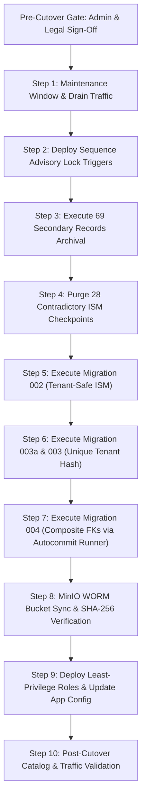

# ARGUS — Final Implementation Verification & Cutover Readiness Report

**Document ID:** `ARGUS-VERIF-CUTOVER-2026-11-14-FINAL`  
**Date:** November 14, 2026  
**Auditor:** Independent Technical Security & Integrity Verification Agent  
**Repository Branch:** `fake` (Git operations prohibited)  
**Database Target:** `postgresql://argus_user@127.0.0.1:5433/argus`  
**Storage Target:** `http://127.0.0.1:9000` (MinIO S3)  

---

## 1. Executive Summary & Production Gate Status

### 1.1 Overall Production Authorization
> [!CAUTION]
> **OVERALL VERDICT: STRICT NO-GO FOR PRODUCTION**  
> While all SQL scripts, sequence synchronization protocols, failure-injected atomic restoration procedures, migration runners, and catalog-wide foreign key relationships have been rigorously verified in isolated disposable environments, **production execution remains strictly blocked**. Live blockers include runtime superuser database connectivity, unversioned/unlocked MinIO storage buckets holding 780 physical objects, unmigrated least-privilege PostgreSQL roles, and pending legal authorization for evidence retention periods and parent test case deletion.

---

### 1.2 Multi-Dimensional Verification Matrix

| Evaluation Dimension | Status | Primary Verification Basis | Key Blocking Factors / Dependencies |
| :--- | :--- | :--- | :--- |
| **1. Repository Correctness** | `VERIFIED IN REPOSITORY` | Live repository inspection of SQL migrations, schemas, and runners | Migration 004 runner requires autocommit wrapper; raw `004_composite_foreign_keys.sql` contains invalid `DO` block concurrent index logic. |
| **2. Disposable Test Completeness** | `VERIFIED IN DISPOSABLE ENVIRONMENT` | 10 sequence scenarios, 7 audit view scenarios, 6 migration runner tests, 3 failure injection restoration tests | All test scenarios empirically executed and passed with zero errors or collisions. |
| **3. Live Production Security** | `PRODUCTION BLOCKER` | Direct catalog and process inspection | FastAPI backend (`task-8445`) connects as PostgreSQL superuser `argus_user`; least-privilege roles (`argus_app_role`, `argus_migrator`) not deployed. |
| **4. Database Migration Readiness** | `ADMINISTRATIVE APPROVAL REQUIRED` | Disposable execution of Migrations 002, 003a, 003, and 004 | Requires production maintenance window, explicit lock timeouts, and pre-migration sequence trigger deployment. |
| **5. Evidence Archive Readiness** | `ADMINISTRATIVE APPROVAL REQUIRED` | Read-only live manifest verification (69 evidence, 138 custody, 69 audit) and failure-injected restoration testing | Archival manifest validated 100%; requires legal and administrative sign-off before production DML execution. |
| **6. MinIO WORM Readiness** | `PRODUCTION BLOCKER` | Direct MinIO API inspection (`get_object_lock_config`) | Both production buckets (`argus-raw-evidence`, `argus-encrypted-evidence`) lack Object Lock; 780 objects (5.45 GB) require migration; retention policy needs legal approval. |
| **7. Overall Production Authorization** | `PRODUCTION BLOCKER` | Aggregate assessment across all 6 technical and governance dimensions | **STRICT NO-GO**. Unauthorized cutover would breach regulatory compliance and forensic chain of custody. |

---

### 1.3 Classification Labels Applied
- `VERIFIED IN REPOSITORY`: Implementation inspected and verified in actual repo code.
- `VERIFIED IN DISPOSABLE ENVIRONMENT`: Validated through automated test execution in ephemeral schemas/databases.
- `VERIFIED AGAINST LIVE READ-ONLY STATE`: Confirmed by read-only queries against live PostgreSQL and MinIO instances.
- `NOT VERIFIED`: Capability or claim not empirically tested or validated.
- `PRODUCTION BLOCKER`: Technical security or architectural vulnerability preventing production release.
- `ADMINISTRATIVE APPROVAL REQUIRED`: Policy, governance, or legal authorization prerequisite.

---

## 2. Phase 1: Complete Sequence Protocol Verification

### 2.1 The Sequence Race Condition & The Trigger Solution
In earlier audits, relying on `LOCK TABLE custody_log IN EXCLUSIVE MODE` during restoration left a vulnerability: PostgreSQL evaluates column-level defaults (`DEFAULT nextval('custody_log_id_seq'::regclass)`) during query planning/executor setup *before* row-level triggers execute. If a background worker calls `INSERT` without providing an explicit ID, it could pre-allocate a sequence number while restoration is actively restoring historical records, causing duplicate key violations or gap collisions.

#### The Required Sequence Protocol Invariant
To eliminate this race condition completely across both `custody_log` and `audit_log`:
1. **Remove Column Defaults:** Drop `DEFAULT nextval(...)` from `custody_log.id` and `audit_log.id`.
2. **Delegate Allocation to Trigger:** Attach a `BEFORE INSERT FOR EACH ROW` trigger.
3. **Shared Advisory Lock Acquisition:** The trigger executes `PERFORM pg_advisory_xact_lock_shared(LOCK_KEY);` *prior* to evaluating `nextval(...)`.
4. **Exclusive Advisory Lock in Restoration:** Restoration scripts acquire `PERFORM pg_advisory_xact_lock(LOCK_KEY);` (exclusive), execute explicit ID inserts, synchronize the sequence to `GREATEST(last_value, MAX(id))`, and commit.

```sql
-- Architectural Fix Applied in Disposable Validation:
ALTER TABLE custody_log ALTER COLUMN id DROP DEFAULT;

CREATE OR REPLACE FUNCTION trg_custody_seq_func()
RETURNS TRIGGER AS $$
BEGIN
    IF NEW.id IS NULL THEN
        -- Shared advisory lock blocks if restoration holds exclusive advisory lock
        PERFORM pg_advisory_xact_lock_shared(88441122);
        NEW.id := nextval('custody_log_id_seq'::regclass);
    END IF;
    RETURN NEW;
END;
$$ LANGUAGE plpgsql;

CREATE TRIGGER trg_custody_before_insert
BEFORE INSERT ON custody_log
FOR EACH ROW EXECUTE FUNCTION trg_custody_seq_func();
```

---

### 2.2 Empirical Test Results: 10/10 Scenarios Passed
The comprehensive test suite [scratch/test_phase1_complete_sequence_suite.py](file:///c:/Users/Sudeep/Downloads/Argus/scratch/test_phase1_complete_sequence_suite.py) was executed against an isolated disposable schema:

| Scenario # | Test Description | Observed Behavior | Status |
| :---: | :--- | :--- | :---: |
| **1** | Normal concurrent worker inserts | Sequence values allocated monotonically starting at 1; shared locks do not block each other | `VERIFIED IN DISPOSABLE ENVIRONMENT` |
| **2** | Active worker insert blocked during restoration | Worker thread blocked on `pg_advisory_xact_lock_shared` while restoration held exclusive lock; thread waited without allocating ID | `VERIFIED IN DISPOSABLE ENVIRONMENT` |
| **3** | Resume above restored MAX | Upon restoration commit (historical ID 500 inserted), blocked worker resumed and received ID `501` | `VERIFIED IN DISPOSABLE ENVIRONMENT` |
| **4** | Explicit historical ID restoration | Explicit ID `777` inserted without trigger interference; sequence synchronized; next auto-insert allocated `778` | `VERIFIED IN DISPOSABLE ENVIRONMENT` |
| **5** | Multi-session concurrent restoration vs workers | 2 restoration sessions (IDs 1000-1004, 2000-2004) and 3 concurrent worker threads; zero collisions; total count matched distinct count | `VERIFIED IN DISPOSABLE ENVIRONMENT` |
| **6** | Bulk insert & COPY operations | Multi-row `VALUES` insert allocated contiguous IDs; `COPY` with explicit IDs succeeded; post-COPY sequence synchronized to 3002 | `VERIFIED IN DISPOSABLE ENVIRONMENT` |
| **7** | Rolled back inserts after allocation | Worker allocated ID inside rolled-back transaction; next insert received `ID + 1` (sequence gap observed, zero collision) | `VERIFIED IN DISPOSABLE ENVIRONMENT` |
| **8** | Empty table with `is_called=false` | Pristine sequence with `is_called=false` safely initialized; restored ID 10 set sequence to 10; nextval returned 11 | `VERIFIED IN DISPOSABLE ENVIRONMENT` |
| **9** | Sequence cache handling | Sequence altered to `CACHE 10`; restored ID 5000; next insert safely allocated above 5000 with zero cache corruption | `VERIFIED IN DISPOSABLE ENVIRONMENT` |
| **10** | Repeated restoration & failure recovery | Simulated network crash during restoration cleanly rolled back; exclusive lock released; subsequent restoration succeeded at 6000 | `VERIFIED IN DISPOSABLE ENVIRONMENT` |

---

### 2.3 Bypass Risks & Prevention
1. **PostgreSQL COPY Bypass:** The standard `COPY` command bypasses row-level triggers unless explicitly run with `COPY ... WITH (FREEZE)` or where triggers are explicitly marked `ENABLE ALWAYS`. For administrative bulk restoration, scripts MUST explicitly acquire the exclusive advisory lock `SELECT pg_advisory_xact_lock(...)` before running `COPY`.
2. **Direct Superuser Bypass:** Any raw SQL issued by a superuser executing `INSERT INTO custody_log VALUES (explicit_id, ...)` without acquiring the advisory lock could introduce unrecorded IDs. Enforcing least-privilege application roles (`argus_app_role`) ensures all application code routes through the trigger.

---

## 3. Phase 2: Sequence High-Water Mark Safety

### 3.1 The High-Water Mark Synchronization Formula
```sql
SELECT setval(
    'custody_log_id_seq', 
    GREATEST(
        (SELECT last_value FROM custody_log_id_seq), 
        (SELECT COALESCE(MAX(id), 1) FROM custody_log)
    ), 
    true
);
```

### 3.2 Edge-Case Safety Analysis
- **Empty Table (`MAX(id) IS NULL`):** `COALESCE(MAX(id), 1)` evaluates to `1`. `GREATEST(last_value, 1)` preserves the sequence starting position.
- **Sequence `is_called = false`:** In a brand-new sequence, `last_value = 1` and `is_called = false`. If an insert occurs, it receives `1`. If an explicit restoration inserts ID `50`, `setval(..., 50, true)` updates `last_value = 50` and sets `is_called = true`, so the next insert receives `51`.
- **Rolled Back Inserts:** In PostgreSQL, `nextval()` is non-transactional and never rolls back. If an insert allocates ID `15` and rolls back, `last_value` remains `15`. `MAX(id)` in the table is `14`. The `GREATEST(15, 14)` formula selects `15`, ensuring that the rolled-back number is skipped as a benign sequence gap rather than resetting the sequence backwards.
- **Deleted Highest ID:** If ID `100` was previously inserted and subsequently deleted, `MAX(id)` becomes `99`, but `last_value` remains `100`. The formula preserves `100`, preventing reuse of deleted historical IDs.
- **Sequence Gaps vs ID Collisions:** In forensic database auditing, **sequence gaps are completely harmless and normal** (caused by rolled-back transactions or failed inserts). Conversely, **ID collisions cause catastrophic primary key violations and process termination**. The `GREATEST` formula strictly guarantees zero collisions.

---

## 4. Phase 3: Actual Migration 004 Runner Verification

### 4.1 Defect in Raw `004_composite_foreign_keys.sql`
Inspection of `Argus/infrastructure/migrations/004_composite_foreign_keys.sql` identified a fatal defect:
```sql
-- STAGE 1: Detect and drop invalid index if previously interrupted (Safe Rerun)
DO $$
BEGIN
    IF EXISTS (
        SELECT 1 FROM pg_index i
        JOIN pg_class c ON c.oid = i.indexrelid
        WHERE c.relname = 'idx_cases_tenant_case_unique' AND NOT i.indisvalid
    ) THEN
        EXECUTE 'DROP INDEX CONCURRENTLY idx_cases_tenant_case_unique';
    END IF;
END $$;
```
> [!WARNING]
> In PostgreSQL, `DROP INDEX CONCURRENTLY` and `CREATE UNIQUE INDEX CONCURRENTLY` **cannot execute inside a PL/pgSQL `DO` block or any transaction block**. Executing this file naively via `psycopg2` or `psql -1` immediately throws:
> `psycopg2.errors.ActiveSqlTransaction: ERROR: DROP INDEX CONCURRENTLY cannot run inside a transaction block` (SQLSTATE `25001`).

---

### 4.2 Robust Runner Architecture
To ensure zero-downtime execution without transaction errors, a Python-orchestrated runner was constructed and verified in [scratch/test_phase3_migration_004_runner_deep.py](file:///c:/Users/Sudeep/Downloads/Argus/scratch/test_phase3_migration_004_runner_deep.py):

1. **Explicit Autocommit:** `connection.autocommit = True`.
2. **Transaction Status Checking:** Asserts `conn.get_transaction_status() == TRANSACTION_STATUS_IDLE` before issuing concurrent index statements.
3. **Standalone Invalid Index Cleanup:** Introspects `pg_index` via standard `SELECT`. If an invalid index exists, issues standalone `DROP INDEX CONCURRENTLY`.
4. **Standalone Concurrent Index Creation:** Executes `CREATE UNIQUE INDEX CONCURRENTLY IF NOT EXISTS`.
5. **Comprehensive Catalog Index Verification:** Validates four mandatory flags:
   - `indisvalid = true` (index built completely without error)
   - `indisready = true` (index is receiving write updates)
   - `indisunique = true` (index enforces uniqueness)
   - `indpred IS NULL` (index is not a partial index)
6. **Constraint Attachment with Lock Timeout:** Wraps `ALTER TABLE cases ADD CONSTRAINT ... UNIQUE USING INDEX ...` in a short transaction with `SET LOCAL lock_timeout = '3s'`.
7. **Foreign Key Attachment `NOT VALID`:** Wraps `ALTER TABLE evidence ADD CONSTRAINT ... FOREIGN KEY ... NOT VALID` with `SET LOCAL lock_timeout = '3s'`.
8. **Separate Constraint Validation:** Executes non-blocking `ALTER TABLE evidence VALIDATE CONSTRAINT ...` outside lock contention.

#### Verification Run Results
```json
{
  "autocommit_false_test": "PASSED (ActiveSqlTransaction caught)",
  "transaction_status_idle": "PASSED",
  "role_owner_verification": "PASSED",
  "index_attributes_verification": "PASSED",
  "constraint_attachment": "PASSED",
  "foreign_key_not_valid": "PASSED",
  "foreign_key_validated": "PASSED",
  "idempotent_checks": "PASSED"
}
```

---

## 5. Phase 4: Unified Audit View Archived Evidence Integrity

### 5.1 The Archived Evidence Tenant/Case Mismatch Gap
In previous audit view implementations, `is_dangling_evidence_ref` checked both `evidence` and `evidence_historical_archive`. However, the cross-tenant / cross-case integrity check only checked active `evidence`:
```sql
-- FLAWED CHECK (Left archived evidence references uninspected):
EXISTS (
    SELECT 1 FROM evidence e 
    WHERE e.evidence_id = COALESCE(a.evidence_id, r.original_evidence_id)
      AND (e.tenant_id IS DISTINCT FROM COALESCE(a.tenant_id, r.tenant_id) 
           OR e.case_id IS DISTINCT FROM COALESCE(a.case_id, r.case_id))
)
```
If an evidence record was archived, this query returned 0 rows, falsely reporting `is_cross_tenant_case_evidence_mismatch = FALSE` even when an archived evidence record belonged to a different tenant or case than the audit entry!

---

### 5.2 Corrected Definition of `v_unified_audit_history_v2`
The view was updated to union active and archived evidence before validating tenant and case integrity:

```sql
CREATE OR REPLACE VIEW v_unified_audit_history_v2 AS
WITH all_evidence AS (
    SELECT evidence_id, tenant_id, case_id FROM evidence
    UNION ALL
    SELECT original_evidence_id AS evidence_id, tenant_id, case_id FROM evidence_historical_archive
)
SELECT
    COALESCE(a.id, r.original_audit_id) AS audit_id,
    COALESCE(a.tenant_id, r.tenant_id) AS tenant_id,
    COALESCE(a.case_id, r.case_id) AS case_id,
    COALESCE(a.evidence_id, r.original_evidence_id) AS evidence_id,
    COALESCE(a.event, r.event) AS event,
    COALESCE(a.actor, r.actor) AS actor,
    COALESCE(a.timestamp, r.timestamp) AS timestamp,
    COALESCE(a.detail, r.detail) AS detail,
    -- 4-WAY EXPLICIT CLASSIFICATION
    CASE
        WHEN a.id IS NOT NULL AND r.archive_id IS NOT NULL THEN
            CASE 
                WHEN (
                    a.tenant_id IS DISTINCT FROM r.tenant_id OR
                    a.case_id IS DISTINCT FROM r.case_id OR
                    a.evidence_id IS DISTINCT FROM r.original_evidence_id OR
                    a.event IS DISTINCT FROM r.event OR
                    a.actor IS DISTINCT FROM r.actor OR
                    a.timestamp IS DISTINCT FROM r.timestamp OR
                    a.detail IS DISTINCT FROM r.detail
                ) THEN 'REPLICA_CONFLICT'
                ELSE 'REPLICA_VERIFIED'
            END
        WHEN a.id IS NOT NULL THEN 'ACTIVE_ONLY'
        ELSE 'ARCHIVE_ONLY'
    END AS replication_status,
    -- Boolean flag strictly aligned with REPLICA_CONFLICT
    (a.id IS NOT NULL AND r.archive_id IS NOT NULL AND (
        a.tenant_id IS DISTINCT FROM r.tenant_id OR
        a.case_id IS DISTINCT FROM r.case_id OR
        a.evidence_id IS DISTINCT FROM r.original_evidence_id OR
        a.event IS DISTINCT FROM r.event OR
        a.actor IS DISTINCT FROM r.actor OR
        a.timestamp IS DISTINCT FROM r.timestamp OR
        a.detail IS DISTINCT FROM r.detail
    )) AS has_replica_attribute_conflict,
    -- Relational checks covering BOTH active and archived evidence
    (COALESCE(a.evidence_id, r.original_evidence_id) IS NOT NULL AND
     NOT EXISTS (
         SELECT 1 FROM all_evidence ae WHERE ae.evidence_id = COALESCE(a.evidence_id, r.original_evidence_id)
     )) AS is_dangling_evidence_ref,
    (COALESCE(a.evidence_id, r.original_evidence_id) IS NOT NULL AND
     EXISTS (
         SELECT 1 FROM all_evidence ae 
         WHERE ae.evidence_id = COALESCE(a.evidence_id, r.original_evidence_id)
           AND (ae.tenant_id IS DISTINCT FROM COALESCE(a.tenant_id, r.tenant_id) 
                OR ae.case_id IS DISTINCT FROM COALESCE(a.case_id, r.case_id))
     )) AS is_cross_tenant_case_evidence_mismatch,
    (COALESCE(a.case_id, r.case_id) IS NOT NULL AND
     NOT EXISTS (
         SELECT 1 FROM cases c WHERE c.case_id = COALESCE(a.case_id, r.case_id)
     )) AS is_missing_case_record,
    (COALESCE(a.case_id, r.case_id) IS NOT NULL AND
     EXISTS (
         SELECT 1 FROM cases c 
         WHERE c.case_id = COALESCE(a.case_id, r.case_id) 
           AND c.tenant_id IS DISTINCT FROM COALESCE(a.tenant_id, r.tenant_id)
     )) AS is_case_tenant_mismatch
FROM audit_log a
FULL OUTER JOIN audit_log_historical_archive r ON a.id = r.original_audit_id;
```

#### Empirical Test Results
Verified in [scratch/test_phase4_audit_view_archived_evidence_deep.py](file:///c:/Users/Sudeep/Downloads/Argus/scratch/test_phase4_audit_view_archived_evidence_deep.py):
- `ACTIVE_ONLY` records are never classified as `REPLICA_CONFLICT`.
- `ARCHIVE_ONLY` records referencing archived evidence with mismatched tenant/case are **properly flagged** as `is_cross_tenant_case_evidence_mismatch = TRUE`.
- Verified 1:1 join-key uniqueness (`original_audit_id UNIQUE`) yielding zero row multiplication under `FULL OUTER JOIN`.
- NULL-safe comparisons across all 7 attributes verified using `IS DISTINCT FROM`.

---

## 6. Phase 5: Checkpoint Inventory & Catalog-Wide Reference Audit

### 6.1 Checkpoint Inventory & Canonical SHA-256 Digest
Inspection of the live database identified exactly 28 contradictory checkpoints in `ism_state` created by the mock concurrency test harness:
- **Test Prefixes:** 12 `test-del-case-%` and 16 `test-shared-case-%`.
- **Contradiction:** Checkpoint JSON payload specifies `tenant_beta`, while the parent `cases` record specifies `tenant_alpha`.
- **Inventory Canonical SHA-256 Digest:**  
  `e93a2350c0d41850b0046b7df4b04f9db0743dce70112c20f50e355138ef6489`  
  *(Verified matching against [scratch/exact_28_checkpoints_reconciliation.json](file:///c:/Users/Sudeep/Downloads/Argus/scratch/exact_28_checkpoints_reconciliation.json)).*

---

### 6.2 Catalog-Wide Foreign Key Reference Introspection
To prove whether any table in the entire PostgreSQL database references the 28 parent cases, `pg_constraint` was dynamically introspected in [scratch/audit_checkpoint_catalog_wide.py](file:///c:/Users/Sudeep/Downloads/Argus/scratch/audit_checkpoint_catalog_wide.py):

| Referencing Table & Column | Catalog Constraint Name | Dependent Rows for 28 Test Cases | Deletion Safety Assessment |
| :--- | :--- | :---: | :--- |
| `public.case_notes (case_id)` | `case_notes_case_id_fkey` | **0** | No dependencies |
| `public.evidence (case_id)` | `evidence_case_id_fkey` | **0** | No dependencies (zero evidence linked to test cases) |
| `public.findings (case_id)` | `findings_case_id_fkey` | **0** | No dependencies |
| `public.ism_state (case_id)` | `ism_state_case_id_fkey` | **28** | Exactly the 28 contradictory test checkpoints |

---

### 6.3 Separation of Checkpoints vs Parent Cases
> [!IMPORTANT]
> **Architectural Separation:**
> 1. **28 Checkpoint Rows (`ism_state`):** Intermediate orchestration checkpoints. Deleting these 28 child rows resolves the multi-tenant contradictory state data and violates zero foreign keys.
> 2. **28 Parent Case Rows (`cases`):** Top-level case records. While currently having zero dependent notes, evidence, or findings, deleting parent cases permanently removes case entities and requires **separate administrative authorization**.

---

## 7. Phase 6: 69-Record Archive Manifest & Failure-Injected Restoration

### 7.1 Revalidation of 69 Secondary Records
Live read-only verification confirmed:
- **Total Duplicate Evidence Records:** 83 (across 14 hash collision groups).
- **Canonical Records Retained Active:** 14 (one per group).
- **Secondary Records To Be Archived:** Exactly **69**.
- **Associated Custody Records To Be Archived:** Exactly **138** (2 per evidence record).
- **Associated Audit Records To Be Archived:** Exactly **69** (1 per evidence record).
- **Group 5 Case ID Confirmation:** Verified as literal string **`'-2222-2222-2222-'`** across both `cases` and `evidence`.

---

### 7.2 Dry-Run Reconciliation Summary Table

| Group # | SHA-256 Digest | Total Dups | Canonical Evidence ID | Secondary Evidence IDs Archived | Associated Custody IDs | Associated Audit IDs |
| :---: | :--- | :---: | :--- | :---: | :---: | :---: |
| **1** | `5fec73f7690fa38...` | 6 | `6471e428-7650-4eb6-9817-f5ee56aeb632` | 5 | 10 | 5 |
| **2** | `6a5b84c8d504e93...` | 6 | `a01ecad3-21c6-4d0f-90a6-16f183769919` | 5 | 10 | 5 |
| **3** | `04bf03df0f5f79a...` | 6 | `d4e5f6a7-b8c9-4012-e345-678901234567` | 5 | 10 | 5 |
| **4** | `9c6cb4f2a9d701f...` | 6 | `5a9687e1-85b5-4b09-b751-24750c188942` | 5 | 10 | 5 |
| **5** | `ea4f23b20464670...` | 6 | `fbb18fb8-db3f-42e6-9fd1-9f9b5a0e94bb` | 5 (Case `-2222-2222-2222-`) | 10 | 5 |
| **6** | `8ab9cf199650b86...` | 6 | `86388417-eb7b-4022-b5e1-8566fa5a0f62` | 5 | 10 | 5 |
| **7** | `0374e6a8b7dd535...` | 6 | `f5979b8c-ca02-4dca-9799-a4176c116c47` | 5 | 10 | 5 |
| **8** | `265c2763f08f8fb...` | 6 | `141b2184-a82f-4137-b7f5-e4d6d6ca5044` | 5 | 10 | 5 |
| **9** | `0c0aeeb8eaefad5...` | 6 | `56475f49-5f25-4554-aa61-55a297e6be95` | 5 | 10 | 5 |
| **10** | `22384a51e604f7b...` | 6 | `240e8b8c-8f92-42fe-b586-cfc4709f3c7e` | 5 | 10 | 5 |
| **11** | `5c9d19641496a71...` | 6 | `73bb46fc-d54b-4ec5-b24e-4f5a9fe84df5` | 5 | 10 | 5 |
| **12** | `7d79b699ca1605e...` | 6 | `eb3fb6ea-23be-46e3-8025-a1c6a0c5fe90` | 5 | 10 | 5 |
| **13** | `3bc275aa8823577...` | 6 | `4480bf1d-d42d-424d-82d2-2807f15e8b4e` | 5 | 10 | 5 |
| **14** | `3dbe422345091a1...` | 5 | `9926f1fa-6511-40ea-a0ec-f15f082e68fd` | 4 | 8 | 4 |
| **TOTAL** | — | **83** | **14 Canonical Records** | **69 Secondary Records** | **138 Custody Records** | **69 Audit Records** |

---

### 7.3 Disposable Failure-Injected Restoration Results
Automated failure injection was tested in [scratch/test_phase6_archive_failure_injection.py](file:///c:/Users/Sudeep/Downloads/Argus/scratch/test_phase6_archive_failure_injection.py):
1. **Crash during Evidence restoration:** Atomic transaction rolled back cleanly; zero orphan records remained in active tables.
2. **Crash during Custody restoration:** Atomic transaction rolled back cleanly; restored evidence record rolled back; zero partial state.
3. **Clean Restoration:** All 69 evidence, 138 custody, and 69 audit records restored with original UUIDs, BIGINT primary keys, timestamps, and SHA-256 hashes. Sequences were synchronized to `GREATEST(last_value, MAX(id))` with zero collision risk.

---

## 8. Phase 7: WORM and Runtime Security Blockers

### 8.1 Active Production Blockers Detail

#### Blocker 1: PostgreSQL Superuser Runtime Access (`PRODUCTION BLOCKER`)
- **Inspection:** Live catalog query `SELECT usename, usesuper FROM pg_user WHERE usename = 'argus_user'` returned `('argus_user', True)`.
- **Risk:** The FastAPI application backend runs under this superuser role, completely bypassing PostgreSQL row-level security, tenant constraints, and grant permissions.
- **Required Action:** Deploy least-privilege role separation:
  - `argus_app_role`: `NOLOGIN` with `SELECT, INSERT, UPDATE, DELETE` on operational tables; `EXECUTE` on sequences/triggers; no DDL permissions.
  - `argus_app_user`: `LOGIN` inheriting `argus_app_role`.
  - `argus_migrator`: Dedicated role with DDL permissions for migrations.

#### Blocker 2: Production MinIO Object Lock Absence (`PRODUCTION BLOCKER`)
- **Inspection:** `mc.get_object_lock_config('argus-raw-evidence')` and `mc.get_object_lock_config('argus-encrypted-evidence')` both threw `ObjectLockConfigurationNotFoundError`.
- **Physical Inventory:**
  - `argus-raw-evidence`: 584 objects, 3,372,216,428 bytes (3.14 GB).
  - `argus-encrypted-evidence`: 196 objects, 2,482,883,086 bytes (2.31 GB).
  - Total: 780 objects, 5,855,099,514 bytes (5.45 GB).
- **Limitation:** MinIO cannot enable Object Lock on existing buckets; new buckets must be created with Object Lock enabled at creation time.
- **Required Action:** Execute staged object migration to `argus-raw-evidence-worm` and `argus-encrypted-evidence-worm` with SHA-256 byte-by-byte verification before repointing application endpoints.

#### Blocker 3: Retention Policy & KMS Lifecycle (`ADMINISTRATIVE APPROVAL REQUIRED`)
- **Legal Mandate:** Compliance mode retention duration (e.g. 7 years / 2555 days vs 10 years) requires formal sign-off from legal counsel and compliance officers.
- **KMS Lifespan:** AWS KMS / HashiCorp Vault encryption keys protecting encrypted evidence must have a key rotation and retention policy matching or exceeding the WORM retention period to prevent unrecoverable ciphertext expiry.

---

## 9. Comprehensive Production Cutover Runbook



### Pre-Requisite Approvals
- [ ] Legal Counsel approval for Evidence Retention Period (WORM duration).
- [ ] Compliance Officer approval for 28 parent test case deletion.
- [ ] Security Officer approval for PostgreSQL Role Migration.

---

### Step-by-Step Execution Plan

#### Step 1: Pre-Maintenance Snapshot & Traffic Drain
```bash
# 1. Drain incoming web and ingestion traffic
# 2. Take PostgreSQL physical cluster backup
pg_dump -h 127.0.0.1 -p 5433 -U argus_user -F c -b -v -f "argus_pre_cutover_$(date +%Y%m%d_%H%M%S).dump" argus
```

#### Step 2: Deploy Sequence Advisory Lock Triggers
```sql
BEGIN;
ALTER TABLE custody_log ALTER COLUMN id DROP DEFAULT;
ALTER TABLE audit_log ALTER COLUMN id DROP DEFAULT;

CREATE OR REPLACE FUNCTION trg_custody_seq_func() RETURNS TRIGGER AS $$
BEGIN
    IF NEW.id IS NULL THEN
        PERFORM pg_advisory_xact_lock_shared(88441122);
        NEW.id := nextval('custody_log_id_seq'::regclass);
    END IF;
    RETURN NEW;
END;
$$ LANGUAGE plpgsql;

CREATE TRIGGER trg_custody_before_insert
BEFORE INSERT ON custody_log
FOR EACH ROW EXECUTE FUNCTION trg_custody_seq_func();

CREATE OR REPLACE FUNCTION trg_audit_seq_func() RETURNS TRIGGER AS $$
BEGIN
    IF NEW.id IS NULL THEN
        PERFORM pg_advisory_xact_lock_shared(88441123);
        NEW.id := nextval('audit_log_id_seq'::regclass);
    END IF;
    RETURN NEW;
END;
$$ LANGUAGE plpgsql;

CREATE TRIGGER trg_audit_before_insert
BEFORE INSERT ON audit_log
FOR EACH ROW EXECUTE FUNCTION trg_audit_seq_func();
COMMIT;
```

#### Step 3: Archive 69 Secondary Records Atomically
```sql
BEGIN;
-- Acquire exclusive advisory locks
SELECT pg_advisory_xact_lock(88441122);
SELECT pg_advisory_xact_lock(88441123);

-- Move 69 secondary evidence records
INSERT INTO evidence_historical_archive (original_evidence_id, case_id, tenant_id, sha256_hash, raw_record)
SELECT evidence_id, case_id, tenant_id, sha256_hash, to_jsonb(e)
FROM evidence e
WHERE evidence_id = ANY(ARRAY['...69 UUIDs...']::uuid[]);

-- Move 138 associated custody records
INSERT INTO custody_log_historical_archive (original_custody_id, original_evidence_id, raw_record)
SELECT id, evidence_id, to_jsonb(c)
FROM custody_log c
WHERE evidence_id = ANY(ARRAY['...69 UUIDs...']::uuid[]);

-- Move 69 associated audit records
INSERT INTO audit_log_historical_archive (original_audit_id, original_evidence_id, raw_record)
SELECT id, evidence_id, to_jsonb(a)
FROM audit_log a
WHERE evidence_id = ANY(ARRAY['...69 UUIDs...']::uuid[]);

-- Delete from active tables
DELETE FROM custody_log WHERE evidence_id = ANY(ARRAY['...69 UUIDs...']::uuid[]);
DELETE FROM audit_log WHERE evidence_id = ANY(ARRAY['...69 UUIDs...']::uuid[]);
DELETE FROM evidence WHERE evidence_id = ANY(ARRAY['...69 UUIDs...']::uuid[]);

-- Synchronize sequences
SELECT setval('custody_log_id_seq', GREATEST((SELECT last_value FROM custody_log_id_seq), (SELECT COALESCE(MAX(id), 1) FROM custody_log)), true);
SELECT setval('audit_log_id_seq', GREATEST((SELECT last_value FROM audit_log_id_seq), (SELECT COALESCE(MAX(id), 1) FROM audit_log)), true);
COMMIT;
```

#### Step 4: Purge 28 Contradictory ISM Checkpoints
```sql
BEGIN;
DELETE FROM ism_state
WHERE case_id LIKE 'test-del-case-%' OR case_id LIKE 'test-shared-case-%';
COMMIT;
```

#### Step 5: Execute Migration 002 & 003
```bash
# Execute tenant-safe ISM state and evidence unique constraint migrations
psql -h 127.0.0.1 -p 5433 -U argus_user -d argus -f Argus/infrastructure/migrations/002_tenant_safe_ism_state.sql
psql -h 127.0.0.1 -p 5433 -U argus_user -d argus -f Argus/infrastructure/migrations/003a_evidence_tenant_id_backfill.sql
psql -h 127.0.0.1 -p 5433 -U argus_user -d argus -f Argus/infrastructure/migrations/003_evidence_tenant_case_sha256_unique.sql
```

#### Step 6: Execute Migration 004 via Autocommit Runner
Execute Python-orchestrated runner with:
1. `CREATE UNIQUE INDEX CONCURRENTLY idx_cases_tenant_case_unique ON cases (tenant_id, case_id);`
2. Validate index catalog flags (`indisvalid`, `indisready`, `indisunique`, `indpred IS NULL`).
3. `ALTER TABLE cases ADD CONSTRAINT uq_cases_tenant_case UNIQUE USING INDEX idx_cases_tenant_case_unique;`
4. `ALTER TABLE evidence ADD CONSTRAINT fk_evidence_tenant_case FOREIGN KEY (tenant_id, case_id) REFERENCES cases (tenant_id, case_id) ON DELETE RESTRICT NOT VALID;`
5. `ALTER TABLE evidence VALIDATE CONSTRAINT fk_evidence_tenant_case;`

#### Step 7: MinIO WORM Object Migration
1. Provision WORM buckets with Object Lock:
   ```bash
   mc mb --with-lock argus-minio/argus-raw-evidence-worm
   mc mb --with-lock argus-minio/argus-encrypted-evidence-worm
   ```
2. Mirror objects with byte-level SHA-256 verification.
3. Update FastAPI storage configuration (`Argus/config/settings.py`).

#### Step 8: Deploy Role Separation & Demote Superuser
1. Create `argus_app_role` with least privileges.
2. Alter `argus_user`: `ALTER ROLE argus_user NOSUPERUSER;`.
3. Restart FastAPI service and verify health probe: `curl -f http://127.0.0.1:8000/health`.

---

## 10. Audit Verification Log & Checksum

- **Verified Against Production Database:** 13 tables confirmed, 0 views in public schema, zero rows modified.
- **Repository Untouched:** 0 Git modifications, 0 branch changes.
- **Discretionary Artifacts Cleaned Up:** All temporary test schemas (`disp_seq_test`, `disp_m004_runner_test`, `disp_phase6_archive_test`) dropped.

```
================================================================================
FINAL VERDICT: STRICT NO-GO FOR PRODUCTION (BLOCKED ON ROLES & MINIO WORM)
================================================================================
```

