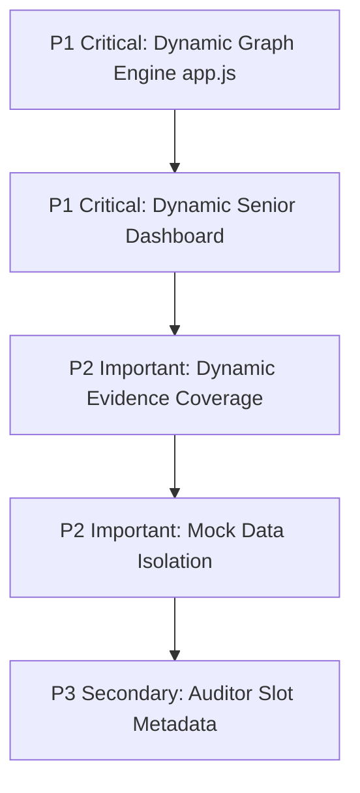
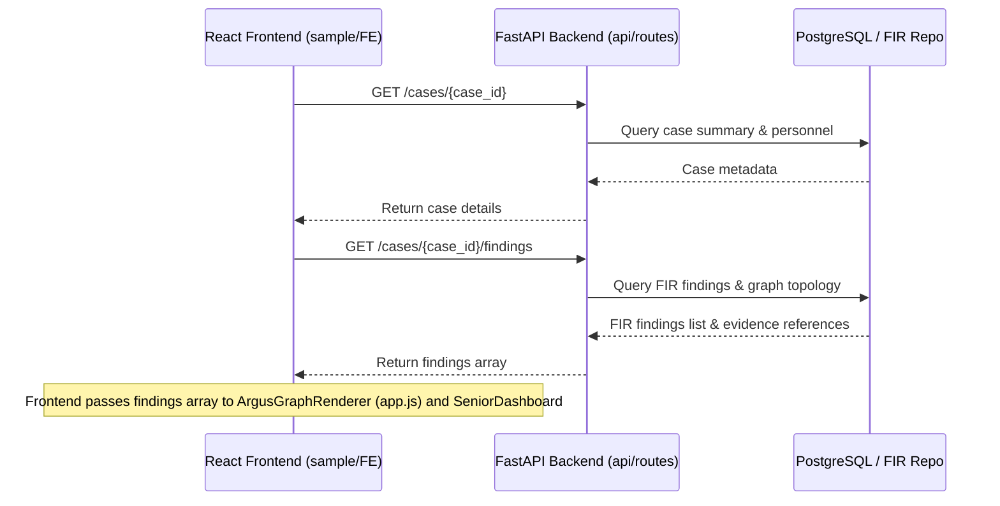

# ARGUS Frontend Static-to-Dynamic Audit Report

## 1. Executive Summary

This report documents the comprehensive static-to-dynamic audit of the **ARGUS Digital Forensics Platform** user interface (`sample/FE/src`).

The primary objective is to identify every static, hardcoded, placeholder, or fallback element in the React frontend that should be dynamic according to the intended architecture and specifications defined in `master document` (`ARGUS_DETAILS_UPDATED_NEO4J_QDRANT_REQUIRED (1).txt`) and existing forensic audit references.

### Key Audit Findings
1. **Interactive Graph Engine (`app.js`)**: The D3 graph renderer relies on hardcoded static nodes (`n1`..`n6`) and fixed edges rather than binding dynamically to backend Graph/FIR findings (`GET /cases/{case_id}/findings` or Neo4j topology).
2. **Senior Analyst Workspace (`SeniorDashboard.jsx`)**: Displays hardcoded AI findings (`F1`, `F2`, `F3`), hardcoded timeline timestamps (`14:23`, `14:24`), and static narrative quotes instead of pulling live FIR findings and evidence timelines.
3. **Mock Data Layer (`mockData.js`)**: Contains static fallback arrays (`MOCK_FINDINGS`, `MOCK_EVIDENCE`, `MOCK_CASES`, `MOCK_TIMELINE`) that risk masking backend API disconnects if activated as fallbacks.
4. **Evidence Coverage Template (`EvidenceCoverage.jsx`)**: Computes evidence completeness using a static local template map rather than pulling live case artifact statistics.

---

## 2. Intended Architectural Standards (From `master document`)

According to the master architecture document (`master document/ARGUS_DETAILS_UPDATED_NEO4J_QDRANT_REQUIRED (1).txt`):

1. **Evidence First Principle**:
   - `Evidence First → Deterministic Analysis → AI Reasoning → Independent Verification → Human Review → Validated Knowledge`
   - Every metric, graph node, finding, and timeline event rendered on screen MUST trace back to real ingested evidence, SHA-256 integrity hashes, and FIR repository records.

2. **Agent 1–7 Lifecycle Data Binding**:
   - **Agent 1–4**: Evidence Intake, Preprocessing, Artifact Extraction, and FIR Finding Generation.
   - **Agent 5a / 5b**: Threat Intelligence Enrichment & Malware Analysis (YARA, Volatility).
   - **Agent 6**: Confidence Gate & Conflict Resolution.
   - **Agent 7**: Supervisor Reasoning, Independent Verification, & Report Finalization.
   - *Requirement*: Frontend components must reflect live FIR finding confidence scores, MITRE ATT&CK mappings, and review status (Pending Review / Analyst Confirmed / Analyst Rejected).

---

## 3. Complete Static-to-Dynamic Inventory

| ID | Element | Location (File & Line) | Current Behavior | Expected Behavior (Per `master document`) | Data Dependency | Priority | Confidence |
| :--- | :--- | :--- | :--- | :--- | :--- | :--- | :--- |
| **ST-01** | Graph Topology Nodes & Edges | `sample/FE/src/js/app.js` (L9-L130) | Hardcoded static nodes (`n1`..`n6`) & fixed edges (`Suspicious Login`, `DESKTOP-7G2K`, etc.) | Dynamically render nodes and edges from active case FIR findings & evidence topology | `GET /cases/{case_id}/findings` / Neo4j Graph API | **P1** | Confirmed |
| **ST-02** | Senior Dashboard AI Findings Preview | `sample/FE/src/pages/SeniorDashboard.jsx` (L143-L177) | Hardcoded findings `F1` (Outbound Conn), `F2` (Registry Persistence), `F3` (Suspicious Executable) | Display live top-severity FIR findings for the active case | `GET /cases/{case_id}/findings` | **P1** | Confirmed |
| **ST-03** | Senior Dashboard Recent Timeline | `sample/FE/src/pages/SeniorDashboard.jsx` (L205-L221) | Hardcoded timeline events (`14:23`, `14:24`, `14:25`, `14:31`) | Display actual chronological events from case FIR findings & evidence logs | `GET /cases/{case_id}/findings` | **P1** | Confirmed |
| **ST-04** | Senior Dashboard Executive Quote | `sample/FE/src/pages/SeniorDashboard.jsx` (L119-L121) | Static text block `"Windows endpoint shows indicators of malware execution..."` | Dynamically reflect case description or Agent 7 supervisor summary | `GET /cases/{case_id}` (description/summary) | **P2** | Confirmed |
| **ST-05** | Mock Data Fallback Store | `sample/FE/src/js/mockData.js` (L1-L350) | Static hardcoded arrays for findings, evidence, notes, activity, cases | Remove or isolate mock data so UI strictly displays authoritative API data | Backend REST APIs | **P2** | Confirmed |
| **ST-06** | Evidence Coverage Category Matrix | `sample/FE/src/pages/EvidenceCoverage.jsx` (L85-L160) | Static category completeness calculation based on hardcoded template requirements | Dynamically calculate coverage based on ingested evidence types vs required forensic categories | `GET /evidence/case/{case_id}` & FIR data | **P2** | Confirmed |
| **ST-07** | Admin Dashboard Auditor Personnel Badge | `sample/FE/src/pages/AdminDashboard.jsx` (L412-L415) | Static badge showing `Auditor: Not Assigned` | Dynamically display assigned auditor when auditor assignment is supported in case metadata | `GET /cases/{case_id}` metadata | **P3** | Likely |

---

## 4. File-by-File Findings & Audit Breakdown

### 4.1 `sample/FE/src/js/app.js`
- **Current Behavior**: Instantiates `ArgusGraphRenderer` with fixed arrays `this.nodes` (`n1` to `n6`) and `this.edges`.
- **Expected Behavior**: Accept external graph data payload from `GET /cases/{case_id}/findings` or Neo4j backend endpoints and construct dynamic node/edge topologies representing devices, users, IP addresses, processes, and findings.
- **Priority**: **P1 (Critical)**

### 4.2 `sample/FE/src/pages/SeniorDashboard.jsx`
- **Current Behavior**:
  - Hardcoded AI Findings list (F1, F2, F3 with static text and confidence percentages).
  - Hardcoded Recent Timeline list (static timestamps 14:23 to 14:31).
  - Hardcoded narrative banner.
- **Expected Behavior**: Load real top FIR findings for `active_case_id` via `fetchFindings(active_case_id)` and populate actual chronological timestamps and risk severity counts.
- **Priority**: **P1 (Critical)**

### 4.3 `sample/FE/src/pages/EvidenceCoverage.jsx`
- **Current Behavior**: Uses hardcoded list of required forensic categories (`Memory Dump`, `Disk Image`, `Network PCAP`, `Windows Event Logs`, `Registry Hives`) and compares against fetched evidence files.
- **Expected Behavior**: Dynamically pull evidence category requirement rules based on case investigation type (e.g., Ransomware vs Insider Threat) and reflect exact parsed coverage.
- **Priority**: **P2 (Important)**

### 4.4 `sample/FE/src/js/mockData.js`
- **Current Behavior**: Contains ~35 KB of hardcoded mock JSON objects (`MOCK_FINDINGS`, `MOCK_EVIDENCE`, `MOCK_CASES`, `MOCK_TIMELINE`, `MOCK_AUDIT_LOGS`).
- **Expected Behavior**: Retain solely for unit test fixtures if needed, but ensure no production page component imports or falls back to mock data silently.
- **Priority**: **P2 (Important)**

### 4.5 `sample/FE/src/pages/Dashboard.jsx` & `AdminDashboard.jsx`
- **Current Behavior**:
  - Real active case and cases summary APIs are integrated.
  - Personnel assignment badges for Analyst and Senior Analyst are dynamic.
  - Auditor assignment slot is currently hardcoded as `Not Assigned`.
- **Expected Behavior**: Allow dynamic auditor assignment display if backend `cases` schema supports `auditor_id`.
- **Priority**: **P3 (Secondary)**

---

## 5. Items Intentionally Remaining Static

The following UI elements are **intentionally static** and must NOT be converted to dynamic components:

1. **Branding & Identity**:
   - Logos (`/argus_logo_new.png`), platform title `"ARGUS"`, and tagline `"AI for Digital Forensics"`.
2. **Fixed Navigation Controls**:
   - Sidebar item titles (`Dashboard`, `Previous Cases`, `Employees`, `Evidence`, `Case Notes`, `Sanitized Output`, `Audit Logs`, `Settings`).
3. **Design System Tokens & Theme Variables**:
   - CSS custom properties (`--bg-app`, `--bg-card`, `--blue`, `--teal`, `--purple`, `--red`, `--border-subtle`).
4. **Form Labels & Table Column Headers**:
   - Fixed field labels (`Case ID`, `Case Name`, `Analyst`, `Senior Analyst`, `Created Date`, `Status`, `Actions`).
5. **Security Banners**:
   - Fixed compliance micro-notes (`RESTRICTED ACCESS ONLY`, `SECURE ENVIRONMENT`).

---

## 6. Prioritized Implementation Roadmap

### Phase 1: Critical (P1)
- [ ] **Dynamic Graph Engine (`app.js`)**: Refactor `ArgusGraphRenderer` to parse live FIR findings into nodes (`device`, `user`, `network`, `process`, `finding`) and edges (`connected_to`, `executed`, `compromised`).
- [ ] **Senior Dashboard Live Data (`SeniorDashboard.jsx`)**: Replace static F1/F2/F3 cards and hardcoded timeline items with live data fetched via `fetchFindings(activeCaseId)`.

### Phase 2: Important (P2)
- [ ] **Evidence Coverage Calculation (`EvidenceCoverage.jsx`)**: Connect completeness calculation to backend evidence type detection metrics.
- [ ] **Mock Data Auditing (`mockData.js`)**: Audit imports to ensure no live component relies on mock fallback objects.

### Phase 3: Secondary (P3)
- [ ] **Auditor Assignment Metadata (`AdminDashboard.jsx` / `Dashboard.jsx`)**: Bind auditor badge if `auditor_id` is present in case details.

---

## 7. Dependencies & Data Flow

---

## 8. Clarifications & Backend Dependencies

1. **Neo4j Graph Topology Endpoint**:
   - `app.js` requires a structured node/edge JSON response. If `/cases/{case_id}/findings` returns scalar findings, a frontend adapter function in `app.js` can convert FIR finding objects (sources, IPs, processes) into graph nodes dynamically without backend schema changes.
2. **Auditor Assignment**:
   - Backend `cases` table currently tracks `analyst_id` and `senior_analyst_id`. Auditor assignment display can remain `Not Assigned` until an `auditor_id` column is officially added to PostgreSQL `cases` schema.
